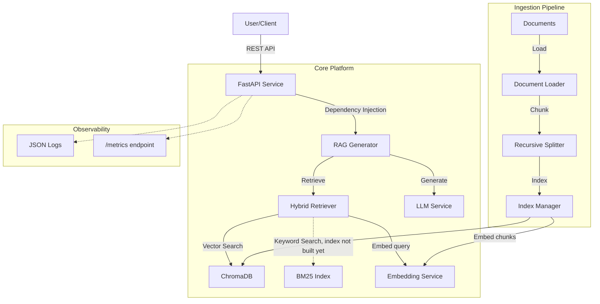

# Enterprise RAG Platform 🚀

A modular **Retrieval-Augmented Generation (RAG)** service built with Python, FastAPI, and ChromaDB. It loads documents, stores their embeddings, and answers questions with an LLM, citing the chunks it used.


## 🌟 Key Features

### Working today

*   **📄 Ingestion**: loaders for PDF, DOCX and TXT, a recursive splitter (512 tokens, 50 overlap), and `examples/ingest_data.py` to embed and store chunks in ChromaDB.
*   **🔌 Embeddings**: two providers, **OpenAI** and **local** (sentence-transformers `all-MiniLM-L6-v2`, the default).
*   **🔎 Retrieval**: vector search in ChromaDB.
*   **🤖 LLM**: one OpenAI-compatible client. It uses OpenAI, or Groq when the model name contains `groq` or `llama`.
*   **🚀 API**: FastAPI with `POST /rag`, `POST /embed`, `GET /health` and `GET /metrics` (Prometheus, via `prometheus-fastapi-instrumentator`).
*   **👁️ Logging**: JSON logs with a correlation ID per request (`X-Request-ID`).
*   **🧪 Tests and CI**: pytest on Python 3.10 and 3.11, plus Black and Flake8, on every push.

### Written, not wired in yet

*   **BM25 and hybrid search**: `BM25Retriever` and Reciprocal Rank Fusion in `HybridRetriever` work in the tests. But nothing builds the BM25 index at ingest, so the API falls back to vector search only.
*   **Embedding cache**: `EmbeddingCache` (memory + disk) is tested but no embedder uses it.
*   **Ragas evaluation**: `src/evaluation/evaluator.py` computes faithfulness, answer relevancy and context precision, but no script runs it yet.
*   **Placeholders**: `src/main_pipeline.py`, `orchestration/airflow/dags/ragshield_dag.py` and `scripts/download_data.py` only print a line, and `infra/terraform/main.tf` is empty.

---

## 🏗️ Architecture



---

## 🚀 Quick Start

### Prerequisites

*   Python 3.10+
*   Docker (optional)
*   API Keys (OpenAI or Groq)

### 1. Installation

```bash
# Clone the repository
git clone https://github.com/ecuadrosg36/enterprise-rag-llm-platform.git
cd enterprise-rag-llm-platform

# Create virtual environment
python -m venv venv
source venv/bin/activate  # Windows: venv\Scripts\activate

# Install dependencies
pip install -r requirements.txt
```

### 2. Configuration

Copy the example environment file and set your keys:

```bash
cp .env.example .env
```

Edit `.env`:
```ini
OPENAI_API_KEY=sk-...
# OR
GROQ_API_KEY=gsk-...

ENV=dev  # dev or prod
```

### 3. Ingest Documents

Place your documents (PDF, TXT, DOCX) in the `data/` directory.

```bash
python examples/ingest_data.py
```

### 4. Run the API

```bash
uvicorn src.api.app:app --reload
```

Visit `http://localhost:8000/docs` for the interactive API documentation.

---

## 🐳 Docker Deployment

Build and run with Docker Compose:

```bash
docker-compose up --build -d
```

*   **API**: `http://localhost:8000`
*   **Health Check**: `http://localhost:8000/health`
*   **Metrics**: `http://localhost:8000/metrics`

---

## 💡 Usage Examples

### Python SDK

```python
from src.core.config import get_config
from src.generation import RAGGenerator, OpenAILLM
from src.retrieval import HybridRetriever, ContextAssembler
from src.embeddings import EmbeddingFactory
from src.vector_store import ChromaVectorStore

# 1. Initialize Components
config = get_config()
embedder = EmbeddingFactory.create(config)
vector_store = ChromaVectorStore(config)
retriever = HybridRetriever(vector_store, embedder)
llm = OpenAILLM(model_name="gpt-3.5-turbo")

# 2. Create Generator
rag = RAGGenerator(llm, retriever, ContextAssembler())

# 3. Ask a Question
response = rag.generate("What is the vacation policy?")

print(f"Answer: {response['answer']}")
print(f"Sources: {[doc['metadata']['source'] for doc in response['source_documents']]}")
```

Or ask questions in the terminal with `python examples/demo_rag.py`.

### API Request

```bash
curl -X POST "http://localhost:8000/rag" \
     -H "Content-Type: application/json" \
     -d '{
           "query": "Explain the project architecture",
           "top_k": 3
         }'
```

---

## 🧪 Testing & Evaluation

Run unit tests:
```bash
pytest tests/
```

The Ragas evaluator in `src/evaluation/` has no runner script yet (see above).

---

## 📁 Project Structure

```
.
├── config/                 # Configuration files (base, dev, prod)
├── data/                   # Your documents for ingestion (create it)
├── examples/               # ingest_data.py, demo_rag.py
├── src/
│   ├── api/                # FastAPI application & routes
│   ├── core/               # Core utilities (config, logging, errors)
│   ├── embeddings/         # Embedding providers (cache written, not used)
│   ├── evaluation/         # Ragas evaluation pipeline
│   ├── generation/         # LLM & RAG logic
│   ├── ingestion/          # Document loaders & chunking
│   ├── retrieval/          # Vector, BM25 and hybrid (RRF) retrievers
│   └── vector_store/       # ChromaDB interface
├── tests/                  # Unit tests
├── Dockerfile              # Docker build definition
└── requirements.txt        # Python dependencies
```

## 🤝 Contributing

1. Fork the repository
2. Create your feature branch (`git checkout -b feature/amazing-feature`)
3. Commit your changes (`git commit -m 'Add amazing feature'`)
4. Push to the branch (`git push origin feature/amazing-feature`)
5. Open a Pull Request
